# viadee Slidev Starter

A light theme for technical presentations, based on the [FH Münster Slidev Starter](https://github.com/mathisarends/fh-muenster-slidev-starter). It retains the original components and layouts, with black text, neutral grays, and viadee coral for the logo and accents. The footer displays the presentation title, chapter, and page number.

## Slide preview

All 16 slides from the example deck in `slides.md`. Click a screenshot to view it at full size. The example slides are in German.

| | |
| --- | --- |
| **1 · Title slide**<br>[](docs/screenshots/1.png) | **2 · Chapter: Context and concepts**<br>[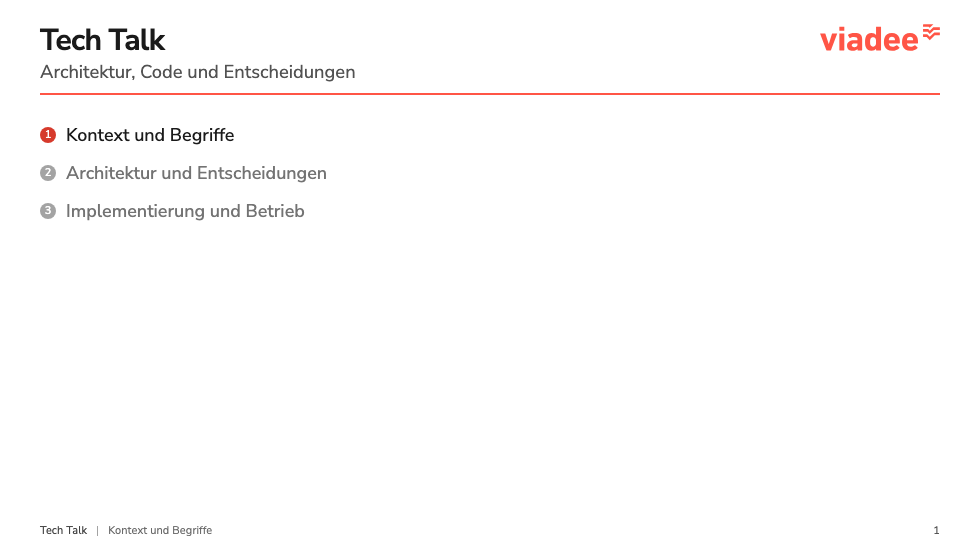](docs/screenshots/2.png) |
| **3 · Definition and text**<br>[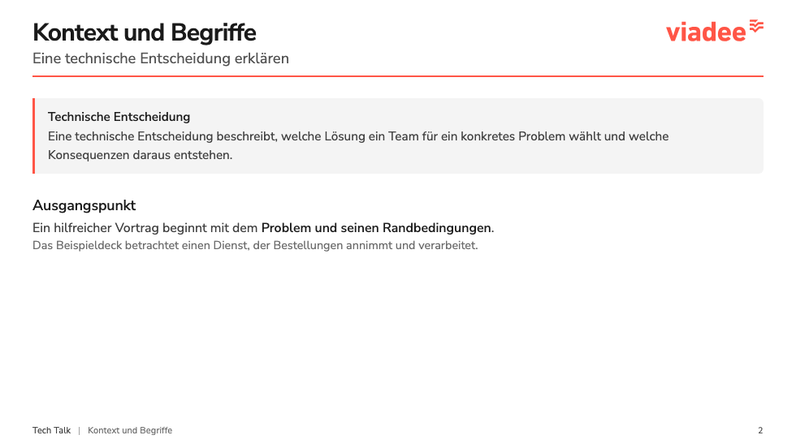](docs/screenshots/3.png) | **4 · Numbered list**<br>[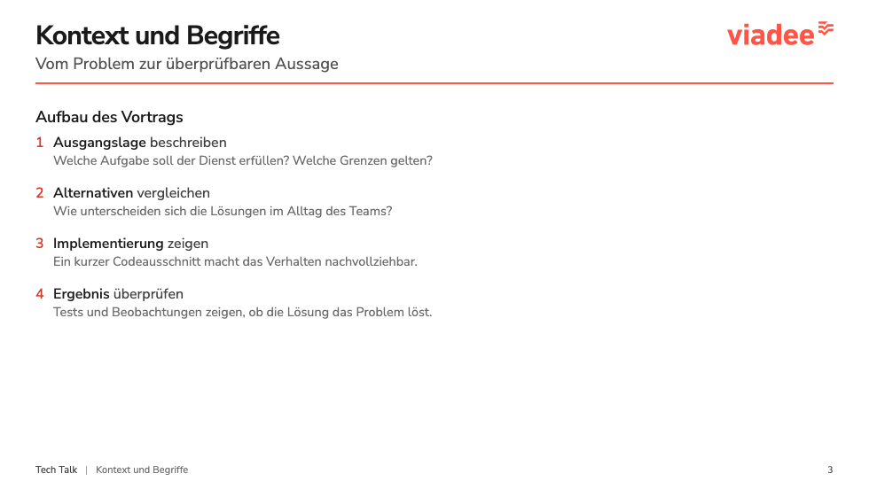](docs/screenshots/4.png) |
| **5 · Chapter: Architecture and decisions**<br>[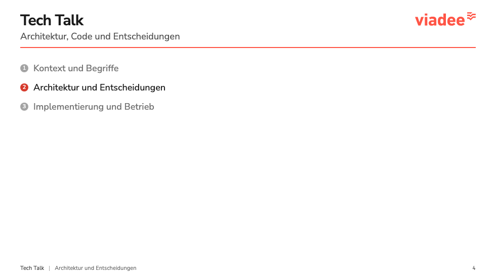](docs/screenshots/5.png) | **6 · Columns and bullet lists**<br>[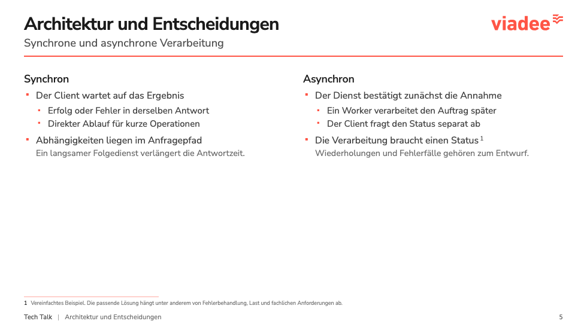](docs/screenshots/6.png) |
| **7 · Mermaid diagram**<br>[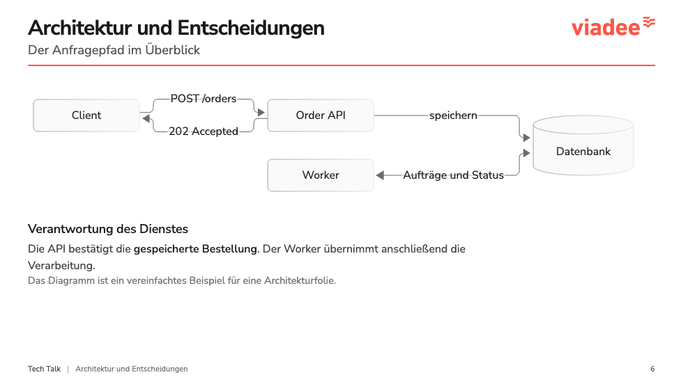](docs/screenshots/7.png) | **8 · Table**<br>[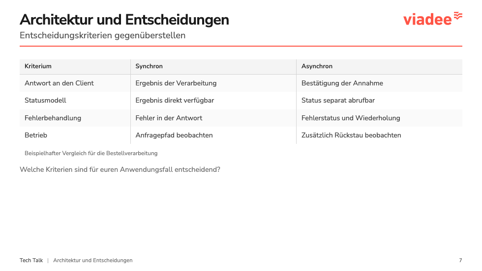](docs/screenshots/8.png) |
| **9 · Chapter: Implementation and operations**<br>[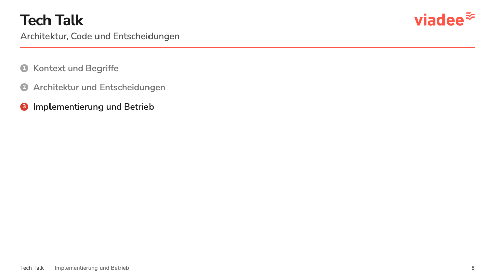](docs/screenshots/9.png) | **10 · Code and example box**<br>[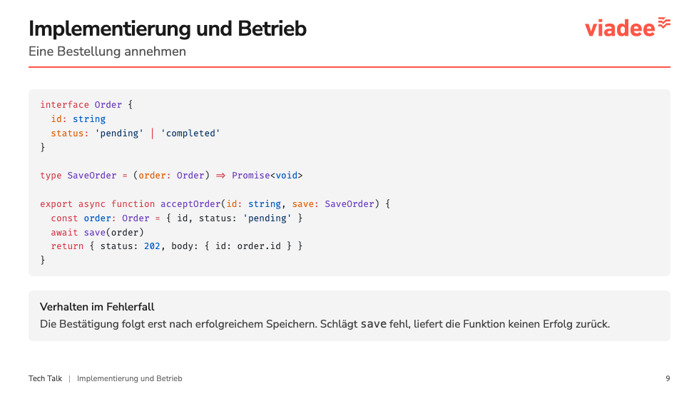](docs/screenshots/10.png) |
| **11 · Code highlighting**<br>[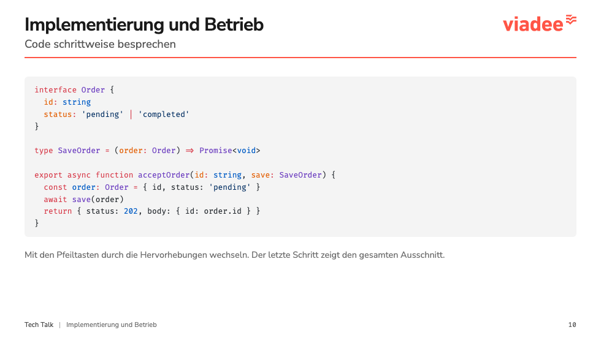](docs/screenshots/11.png) | **12 · Checklist**<br>[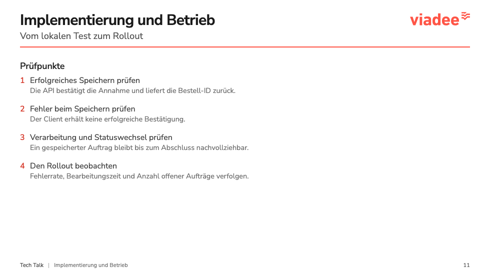](docs/screenshots/12.png) |
| **13 · Image with context**<br>[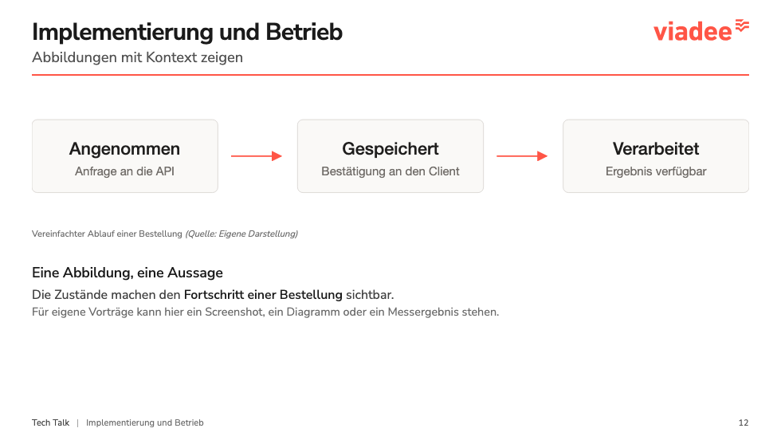](docs/screenshots/13.png) | **14 · Quote box**<br>[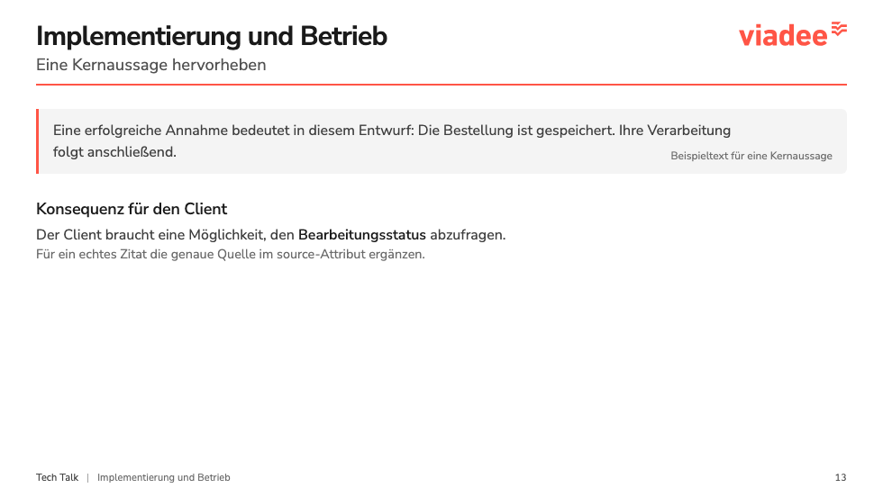](docs/screenshots/14.png) |
| **15 · Summary**<br>[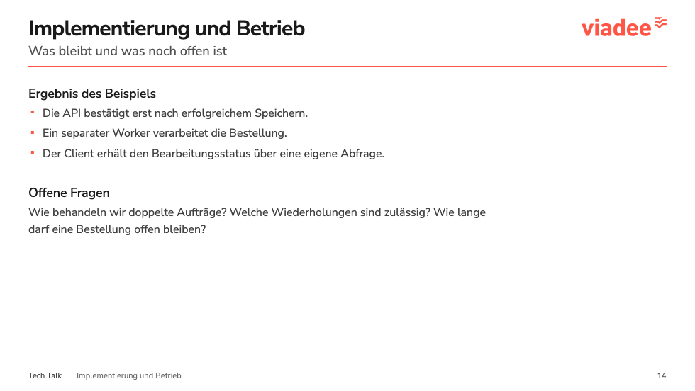](docs/screenshots/15.png) | **16 · Closing slide**<br>[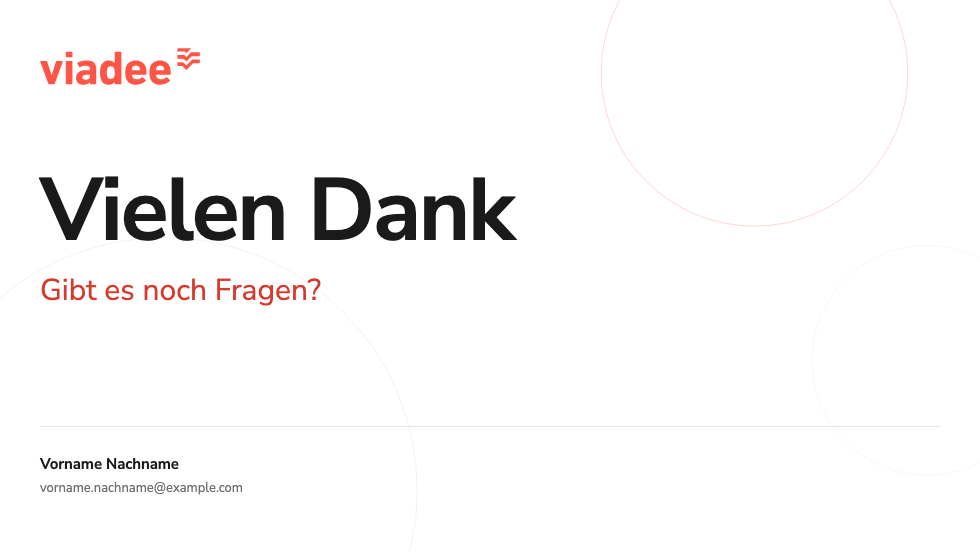](docs/screenshots/16.png) |

## Getting started

Requires Node.js 22.12+ within the 22.x release line, 24.x, or 26+, as specified in `package.json`.

```bash
npm ci
npm run dev
```

The preview runs at `http://localhost:3030`. The `slides.md` file contains the presentation metadata and a 16-slide example deck. Edit the first frontmatter block to set the title, date, event, authors, and chapters.

```bash
npm run lint
npm run build
```

The build output is in `dist/`. Fonts and branding assets are served locally.

## Components and layouts

| Content | Components |
| --- | --- |
| Structure | `SlideLayout`, `Columns`, `Divider` |
| Text | `Text`, `SectionTitle`, `HighlightedText`, `SubText` |
| Lists | `BulletedList`, `NumberedList`, `NumberBadge` |
| Boxes | `DefinitionBox`, `ExampleBox`, `Quotebox` |
| Tables and images | `Table`, `Image` |
| Chapters and references | `ChapterOutline`, `Outline`, `OutlineItem`, `Footnote` |
| Drafts | `Todo` |

Available layouts are `cover`, `chapter-intro`, `default`, and `closing`. Each content slide uses `title`, `subtitle`, and `chapter` in its frontmatter. Chapter numbers refer to `presentationInfo.chapters`. Write code in native Markdown code blocks. Mermaid diagrams use the same neutral styling as the rest of the deck.

`HighlightedText` uses bold black text. The original `fh-*` utilities remain available as color aliases. Colors are defined centrally in `style.css`. See [docs/branding.md](docs/branding.md) for design details and background (in German).

## Export

```bash
npx playwright install chromium
npx slidev export --output /tmp/viadee-template.pdf
```

The Playwright dependency required for export is included. See the [Slidev documentation](https://sli.dev/guide/exporting) for additional options.

After editing the example deck, regenerate the screenshots for the slide preview:

```bash
npx slidev export --format png --output docs/screenshots --scale 1 --wait 700 --timeout 60000
```

## Project background

This project is based on commit `57af20ea67e73b6d0092043abb8560305be2e88a` of the FH Münster starter. The first commit in this repository contains the original template.

The template uses the viadee logo and coral accents. It is an adaptation of the original starter, with no official viadee corporate design approval claimed. The upstream repository did not include a separate license file.

`magic-string` 1.x is pinned to version 1.4.2 to work around an [UnoCSS build issue](https://github.com/unocss/unocss/issues/5373). The 0.30.x version required by Vue is unaffected. Known audit findings in transitive Slidev dependencies remain unresolved; no forced downgrade has been applied.
