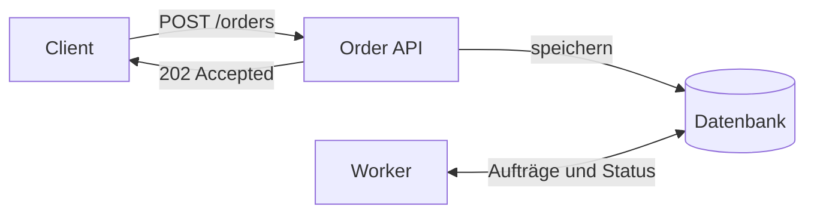

<!--
Diese Präsentation zeigt die Komponenten der Vorlage an einem vereinfachten technischen Beispiel.
Titel, Anlass, Datum und Autor:innen stehen im ersten Frontmatter-Block.
-->

---
layout: chapter-intro
chapter: 1
---

---
title: Kontext und Begriffe
subtitle: Eine technische Entscheidung erklären
chapter: 1
---

<DefinitionBox title="Technische Entscheidung">
  Eine technische Entscheidung beschreibt, welche Lösung ein Team für ein konkretes Problem wählt und welche Konsequenzen daraus entstehen.
</DefinitionBox>

<Text title="Ausgangspunkt">
  Ein hilfreicher Vortrag beginnt mit dem <HighlightedText>Problem und seinen Randbedingungen</HighlightedText>.
  <SubText>Das Beispieldeck betrachtet einen Dienst, der Bestellungen annimmt und verarbeitet.</SubText>
</Text>

---
title: Kontext und Begriffe
subtitle: Vom Problem zur überprüfbaren Aussage
chapter: 1
---

<NumberedList title="Aufbau des Vortrags">
  <li>
    <span><HighlightedText>Ausgangslage</HighlightedText> beschreiben</span>
    <SubText>Welche Aufgabe soll der Dienst erfüllen? Welche Grenzen gelten?</SubText>
  </li>
  <li>
    <span><HighlightedText>Alternativen</HighlightedText> vergleichen</span>
    <SubText>Wie unterscheiden sich die Lösungen im Alltag des Teams?</SubText>
  </li>
  <li>
    <span><HighlightedText>Implementierung</HighlightedText> zeigen</span>
    <SubText>Ein kurzer Codeausschnitt macht das Verhalten nachvollziehbar.</SubText>
  </li>
  <li>
    <span><HighlightedText>Ergebnis</HighlightedText> überprüfen</span>
    <SubText>Tests und Beobachtungen zeigen, ob die Lösung das Problem löst.</SubText>
  </li>
</NumberedList>

---
layout: chapter-intro
chapter: 2
---

---
title: Architektur und Entscheidungen
subtitle: Synchrone und asynchrone Verarbeitung
chapter: 2
---

<Columns>

<BulletedList title="Synchron">
  <li>Der Client wartet auf das Ergebnis
    <ul>
      <li>Erfolg oder Fehler in derselben Antwort</li>
      <li>Direkter Ablauf für kurze Operationen</li>
    </ul>
  </li>
  <li>Abhängigkeiten liegen im Anfragepfad
    <SubText>Ein langsamer Folgedienst verlängert die Antwortzeit.</SubText>
  </li>
</BulletedList>

<BulletedList title="Asynchron">
  <li>Der Dienst bestätigt zunächst die Annahme
    <ul>
      <li>Ein Worker verarbeitet den Auftrag später</li>
      <li>Der Client fragt den Status separat ab</li>
    </ul>
  </li>
  <li>Die Verarbeitung braucht einen Status<Footnote text="Vereinfachtes Beispiel. Die passende Lösung hängt unter anderem von Fehlerbehandlung, Last und fachlichen Anforderungen ab." />
    <SubText>Wiederholungen und Fehlerfälle gehören zum Entwurf.</SubText>
  </li>
</BulletedList>

</Columns>

---
title: Architektur und Entscheidungen
subtitle: Der Anfragepfad im Überblick
chapter: 2
---



<Text title="Verantwortung des Dienstes">
  Die API bestätigt die <HighlightedText>gespeicherte Bestellung</HighlightedText>. Der Worker übernimmt anschließend die Verarbeitung.
  <SubText>Das Diagramm ist ein vereinfachtes Beispiel für eine Architekturfolie.</SubText>
</Text>

---
title: Architektur und Entscheidungen
subtitle: Entscheidungskriterien gegenüberstellen
chapter: 2
---

<Table
  :headers="['Kriterium', 'Synchron', 'Asynchron']"
  :columnWidths="['25%', '37.5%', '37.5%']"
  :rows="[
    ['Antwort an den Client', 'Ergebnis der Verarbeitung', 'Bestätigung der Annahme'],
    ['Statusmodell', 'Ergebnis direkt verfügbar', 'Status separat abrufbar'],
    ['Fehlerbehandlung', 'Fehler in der Antwort', 'Fehlerstatus und Wiederholung'],
    ['Betrieb', 'Anfragepfad beobachten', 'Zusätzlich Rückstau beobachten']
  ]"
  caption="Beispielhafter Vergleich für die Bestellverarbeitung"
/>

<SubText>Welche Kriterien sind für euren Anwendungsfall entscheidend?</SubText>

---
layout: chapter-intro
chapter: 3
---

---
title: Implementierung und Betrieb
subtitle: Eine Bestellung annehmen
chapter: 3
---

```ts
interface Order {
  id: string
  status: 'pending' | 'completed'
}

type SaveOrder = (order: Order) => Promise<void>

export async function acceptOrder(id: string, save: SaveOrder) {
  const order: Order = { id, status: 'pending' }
  await save(order)
  return { status: 202, body: { id: order.id } }
}
```

<ExampleBox title="Verhalten im Fehlerfall">
  Die Bestätigung folgt erst nach erfolgreichem Speichern. Schlägt <code>save</code> fehl, liefert die Funktion keinen Erfolg zurück.
</ExampleBox>

<!--
Die Funktion zeigt die Reihenfolge im Anwendungskern. HTTP-Mapping, Validierung und Idempotenz gehören in den konkreten Dienst.
-->

---
title: Implementierung und Betrieb
subtitle: Code schrittweise besprechen
chapter: 3
---

```ts {1-3|5-7|9-12|all}
interface Order {
  id: string
  status: 'pending' | 'completed'
}

type SaveOrder = (order: Order) => Promise<void>

export async function acceptOrder(id: string, save: SaveOrder) {
  const order: Order = { id, status: 'pending' }
  await save(order)
  return { status: 202, body: { id: order.id } }
}
```

<SubText>Mit den Pfeiltasten durch die Hervorhebungen wechseln. Der letzte Schritt zeigt den gesamten Ausschnitt.</SubText>

---
title: Implementierung und Betrieb
subtitle: Vom lokalen Test zum Rollout
chapter: 3
---

<NumberedList title="Prüfpunkte">
  <li>
    <span>Erfolgreiches Speichern prüfen</span>
    <SubText>Die API bestätigt die Annahme und liefert die Bestell-ID zurück.</SubText>
  </li>
  <li>
    <span>Fehler beim Speichern prüfen</span>
    <SubText>Der Client erhält keine erfolgreiche Bestätigung.</SubText>
  </li>
  <li>
    <span>Verarbeitung und Statuswechsel prüfen</span>
    <SubText>Ein gespeicherter Auftrag bleibt bis zum Abschluss nachvollziehbar.</SubText>
  </li>
  <li>
    <span>Den Rollout beobachten</span>
    <SubText>Fehlerrate, Bearbeitungszeit und Anzahl offener Aufträge verfolgen.</SubText>
  </li>
</NumberedList>

---
title: Implementierung und Betrieb
subtitle: Abbildungen mit Kontext zeigen
chapter: 3
---

<Image
  src="/images/request-flow.svg"
  alt="Bestellung durchläuft die Zustände angenommen, gespeichert und verarbeitet"
  caption="Vereinfachter Ablauf einer Bestellung"
  source="Eigene Darstellung"
  maxWidth="100%"
  height="220px"
/>

<Text title="Eine Abbildung, eine Aussage">
  Die Zustände machen den <HighlightedText>Fortschritt einer Bestellung</HighlightedText> sichtbar.
  <SubText>Für eigene Vorträge kann hier ein Screenshot, ein Diagramm oder ein Messergebnis stehen.</SubText>
</Text>

---
title: Implementierung und Betrieb
subtitle: Eine Kernaussage hervorheben
chapter: 3
---

<Quotebox source="Beispieltext für eine Kernaussage">
  Eine erfolgreiche Annahme bedeutet in diesem Entwurf: Die Bestellung ist gespeichert. Ihre Verarbeitung folgt anschließend.
</Quotebox>

<Text title="Konsequenz für den Client">
  Der Client braucht eine Möglichkeit, den <HighlightedText>Bearbeitungsstatus</HighlightedText> abzufragen.
  <SubText>Für ein echtes Zitat die genaue Quelle im source-Attribut ergänzen.</SubText>
</Text>

---
title: Implementierung und Betrieb
subtitle: Was bleibt und was noch offen ist
chapter: 3
---

<BulletedList title="Ergebnis des Beispiels">
  <li>Die API bestätigt erst nach erfolgreichem Speichern.</li>
  <li>Ein separater Worker verarbeitet die Bestellung.</li>
  <li>Der Client erhält den Bearbeitungsstatus über eine eigene Abfrage.</li>
</BulletedList>

<Text title="Offene Fragen">
  Wie behandeln wir doppelte Aufträge? Welche Wiederholungen sind zulässig? Wie lange darf eine Bestellung offen bleiben?
</Text>

---
layout: closing
---
